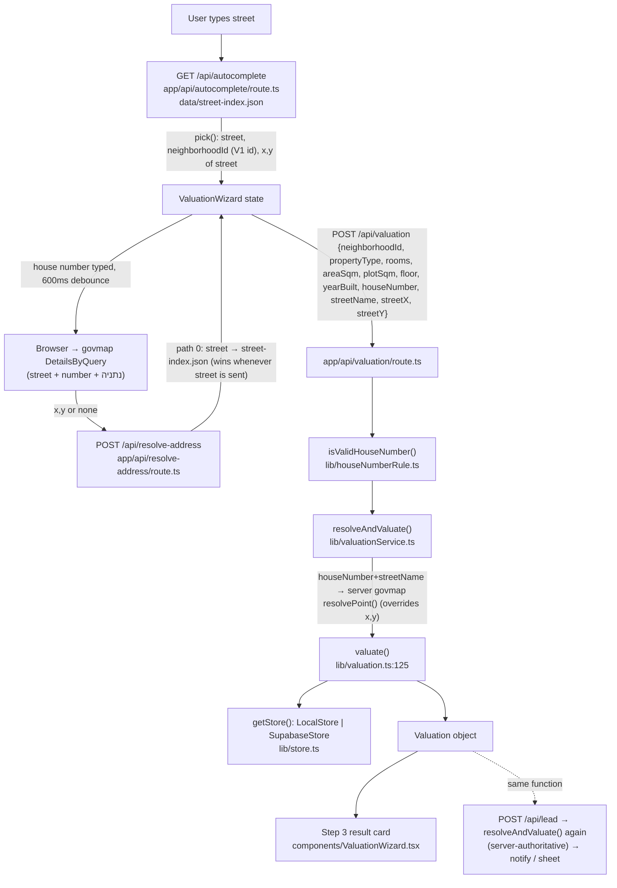

# Valuation Engine — Current State (technical)

Read-only analysis of what the repository's property search, comparable-selection and valuation code **actually does today**. Nothing was modified, fixed, migrated or committed while producing this report. Old docs were used only for history; every rule below was read from the code at `HEAD`.

Line numbers refer to the files as they stand at `HEAD` (`6b28e53`).

---

## 1. Repository state

```
CURRENT_DATE=2026-10-27
CURRENT_BRANCH=master
CURRENT_HEAD=6b28e53044e311744860c69cb4bc66a4247513da
             "feat: launch the פריים homepage and calibrate the valuation range from a 500-search backtest"
```

`git status --short` (excluding `graphify-out/*` and `audit/wave0g*/shadow*` noise):

```
 D next.config.mjs
?? app/prototypes/            ?? public/prototypes/       ?? e2e/round{2,3,4,5}.spec.ts
?? check7.mjs                 ?? data/v2-candidate/deals-v2.json
?? docs/PROJECT_OVERVIEW.md   ?? docs/REDESIGN_PROPOSAL.md ?? docs/*.jpg|png|pdf (design boards)
```

**Uncommitted modifications that affect valuation, comparable search, datasets, matching, confidence, ranges, Supabase reads or performance: none.** The valuation changes made today (range floor, land manual review, house confidence, neighborhood display names, fixture re-pin) are all committed in `6b28e53`.

Notes on the untracked and deleted items:

- **`data/v2-candidate/deals-v2.json`:** untracked, 32 MB. This is the V2 launch dataset that backtests read. It is not used by any app code path.
- **`next.config.mjs`:** deleted in the working tree, but not in git. It contained only `reactStrictMode`, `allowedDevOrigins` and `onDemandEntries`, so it has no valuation impact.

---

## 2. End-to-end valuation flow



| Stage | FILE | FUNCTION | INPUT | OUTPUT | IMPORTANT RULES |
|---|---|---|---|---|---|
| Street autocomplete | `app/api/autocomplete/route.ts` | `GET`, `buildIndex()`, `streetMatches()` | query text | ≤12 suggestions `{street, neighborhoodId, neighborhoodName, x, y}` | Source is `data/street-index.json` (991 rows, 22 neighborhood ids, **all V1 ids**). Matching is a substring match, or all tokens present in any order. Alias dedup goes through `lib/streetAliasDedup.ts`. |
| Street pick | `components/AddressSearch.tsx:88` | `pick()` | suggestion | `StreetSuggestion` with `label = street` | The street-level x,y comes from the index (a street centroid, not the building). |
| Building geocode (browser) | `components/ValuationWizard.tsx:~500` | `useEffect` on house number | `"{street} {n} נתניה"` | building x,y or none | Calls govmap directly from the browser with a 4 s timeout. If govmap answers with no hit, it sets `houseNumberNotFound` and keeps the street suggestion's neighborhood. |
| Neighborhood resolution | `app/api/resolve-address/route.ts` | `POST` | `{street, x, y}` or `{street, address}` | `{neighborhoodId, neighborhoodName, source}` | Priority order:<br/>**0.** exact `street` lookup in `street-index.json`. Always tried first, so in practice it decides the id.<br/>**1.** x,y: the most-weighted `neighborhoodId` among all deals within 1,500 m, weighted by `(1500 − dist)`. Calls `store.getAllDeals()`.<br/>**2.** `streets.json` substring match.<br/>**3.** server-side govmap, then nearest centroid within 5,000 m. |
| House-number gate | `lib/houseNumberRule.ts`, `app/api/valuation/route.ts:16` | `isValidHouseNumber()` | type, houseNumber | 422 or pass | Apartment and house require a house number; land does not. |
| Server geocode | `lib/valuationService.ts:52` | `resolveAndValuate()` | `ValuationInput` | — | If `houseNumber && streetName`, it calls `resolvePoint("{street} {n} נתניה")` (govmap, 8 s timeout, 30-min in-memory cache). A hit **overrides** the browser's streetX/Y. |
| Neighborhood id fallback | `lib/valuationService.ts:96` | `resolveNeighborhoodId()` | free text `query` | id | Only used when no `neighborhoodId` was sent; the wizard always sends one. |
| Valuation | `lib/valuation.ts:125` | `valuate()` | `PropertyInput` | `Valuation` or `null` | Covered in §3–§7. |
| Result | `app/api/valuation/route.ts:24` | — | outcome | 200 `{valuation}` or 422 `no_match` / `insufficient_data` | `null` from `valuate()` becomes 422 `insufficient_data` ("אין מספיק עסקאות"). |
| Lead | `app/api/lead/route.ts:133-146` | `POST` | `valuationInput` | stored lead, notifications | Re-runs `resolveAndValuate()` on the server. Client-sent estimates are ignored. |

### 2.1 Critical finding: the neighborhood-id schemes don't match

The UI always sends a neighborhood id from `data/street-index.json`. Those ids are V1 ids (`66239xxx`). The V2 launch dataset uses a different id space (`652xxxxx`). The two sets have **zero overlap**:

| | Ids | Overlap with street-index |
|---|---|---|
| `street-index.json` | 22 distinct ids | — |
| V1 `data/neighborhoods.json` | 21 ids | 21 |
| V2 `neighborhoods-v2.json` | 38 ids | **0** |
| V2 deal `neighborhoodId`s | 38 ids | **0** |

Against V2 data, `getDealsByNeighborhood(<V1 id>)` therefore returns 0 rows, and every search falls through to the citywide text fallback (`valuation.ts:272`). That fallback has no date window and no room filter (see §3.4). The effect is measured in §10, run C: median error 24.5%, median bias −20.3%, 472 of 500 searches calling `getAllDeals()`.

This does **not** affect the V1 data that local dev uses, and that production held as of 2026-09-02, because both sides use V1 ids. It **does** affect any deployment that serves V2 data, including the planned production cutover and the `PREVIEW_TABLES=1` preview. The L2 acceptance pass on the preview (`audit/launch/L2_PREVIEW_ACCEPTANCE_GO_NO_GO.md`) went through this same fallback.

---

## 3. Comparable search engine

All code in this section is in `lib/valuation.ts`, function `valuate()` (lines 125–590).

### 3.1 Thresholds

| Constant | Value | Location | Meaning |
|---|---|---|---|
| `BUILDING_RADIUS` | 60 m | :12 | Geographic "same building" radius |
| `STREET_RADIUS` | 350 m | :13 | Geographic "near street" tier |
| `COMP_RADIUS_LADDER` | `[500]` m | :14 | Radius fallback inside the neighborhood pool |
| Cross-neighborhood radii | `500, 750, 1000` m | :374 (inline) | Citywide geo fallback |
| `AGE_TOLERANCES` | building 10, street 15, radius 20 years | :15 | ±yearBuilt, only when `input.yearBuilt` is set |
| `WINDOWS` | `[6, 12, 24, 48]` months | :88 | Neighborhood-only time ladder |
| `GEO_MONTHS` | 60 months | :89 | History window for every geographic or text tier (the comment says "4 שנים"; the value is 5 years) |
| `MIN_DEALS_FOR_ROOM_FILTER` | 6 | :90 | Room filter applies only if ≥6 deals survive |
| `MIN_DEALS_FOR_ESTIMATE` | 3 | :91 | Minimum for every tier, and for the final ₪/m² list |
| `MIN_COMPOSITE_DEALS` | 6 | :92 | Minimum for the house/land composite model |
| `MIN_DEALS_FOR_FLOOR_FILTER` | 5 | :93 | Floor filter applies only if ≥5 survive. Also the minimum for the 350 m and 500 m geo tiers. |
| `AREA_TOLERANCE_RATIO` | 0.5 (±50%) | :94 | Area filter, apartment and house only |
| `HOUSE_MAX_PPSQM_BUILT` | ₪40,000 | :95 | Sanity cap: above it the composite house model is dropped |
| `FLOOR_TOLERANCE` | ±2 floors | :96 | Apartment floor filter |
| `MIN_RANGE_HALF` | apartment 0.15, house 0.25 | :101 | Range floor (§5.5) |
| `MIN_PPSQM` | apartment ₪8,000, house ₪12,000, land ₪800 | :108 | Only "non-market" filter (§3.7). Not time-adjusted. |
| `HOUSE_RANGE` | ±12 house numbers | :217 | Same-street "near building" text tier |
| Room tolerance (pools) | `abs(d.rooms − rooms) ≤ 1` | :152, :165, :371 | |
| Display filters | `MAX_SQM_DIFF` 14, `MAX_SQM_WIDE` 25, `MAX_ROOM_DIFF` 0, `MAX_ROOM_WIDE` 1, `MIN_COMPARABLES` 3; house ±25%/±55% composite | :610-614, :640 | **Display list only** (§4) |
| Comparables shown | max 12 | :687, :837 | **Display list only** |
| `MAX_COMPS` used in price | **none**. Every surviving deal is used. | — | |

### 3.2 Pools and order of operations

1. **Pool load** (:147): `pool4yr = getDealsByNeighborhood(input.neighborhoodId, monthsBack: 60)`, filtered to the same `propertyType`. If `input.neighborhoodId` has no deals (the V2 situation in §2.1), this is empty.
2. **`geoPool`** (:150-154): `pool4yr` restricted to rooms ±1, but only if ≥6 remain. Land skips the room filter.
3. **Neighborhood time ladder** (:158-170): for `months` in 6 → 12 → 24 → 48, take `pool4yr` with `dealDate ≥ today − months`, then rooms ±1 if ≥6. Stop at the first window with ≥3 deals. This sets the default `deals`, and `compSearchScope = "neighborhood"`.
   - The window is relative to **`new Date()`** (`cutoffDate()`, :114), not to the dataset's last date. With V2 ending 2026-07-08 and today being 2026-10-27, the "6-month" window holds only about 2.3 months of data.
4. **Text tiers on `geoPool`** (:232-257). These run only when `streetName` is given. Each tier passes through `ageFilter()`, and the first to reach ≥3 deals wins:
   - **a.** Exact building: same normalized street, same `parseInt(houseNumber)`. Scope `"building"`.
   - **b.** Same street, house number within ±12. Scope `"street"`.
   - **c.** Whole street. Scope `"street"`.
   - Every tier sets `windowMonths = 60`.
5. **Citywide text fallback** (:272-290). Runs only if scope is still `"neighborhood"` and `streetName` is given. It calls `getAllDeals()`, filtered to the same type only. There is **no date cutoff, no room filter**, so deals back to 1998 are eligible.
   - **a.** Street + house number within ±12. Labelled scope **`"building"`**, even though it is the ±12 rule, using the 10-year age tolerance.
   - **b.** Whole street citywide. Scope `"street"`.
6. **Geographic tiers.** These run only when `streetX/streetY` are set (:292-388). They use `geoPool` split into located and unlocated deals. Unlocated deals are appended to whichever geo tier wins (:324, :337, :349).
   - **G1** (:301). Runs if scope ≠ building. Takes deals within 60 m; prefers same-street deals in the radius if ≥3. If ≥3 after `ageFilter`, scope becomes `"building"` (if all deals are on the same street) or `"radius"`, with radius 60.
   - **G2** (:334). Runs if scope ∉ {building, street}. Takes deals within 350 m and needs **≥5** after `ageFilter`. Scope `"radius"`, radius 350.
   - **G3** (:345). Runs if scope is still neighborhood. Takes deals within 500 m and needs **≥5** after `ageFilter`.
   - **Cross-neighborhood** (:364-387). Runs if `deals < 3`, or if fewer than 3 deals have `pricePerSqm ≥ MIN_PPSQM`. Calls `getAllDeals()`, keeps the same type and `dealDate ≥ today − 60 months`, applies rooms ±1 if ≥6, then tries radii 500, 750, 1000 m and needs ≥3 deals with ≥3 valid ₪/m². No age filter. This block is **inside** the coordinates branch, so it never runs without coordinates.
7. **Floor filter** (:394-404). Apartment only, when `input.floor` is set. Keeps deals with `|floor − input| ≤ 2` if ≥5 survive. Deals with a null floor are dropped by this filter.
8. **Area filter** (:406-414). Not applied to land. Keeps deals with area in `[0.5×, 1.5×]` of the input if ≥3 survive. Deals with a null area are dropped by this filter.
9. **₪/m² list** (:416-420). Takes `pricePerSqm` values that are not null, finite and `≥ MIN_PPSQM[type]`. If fewer than 3 remain, `valuate()` **returns `null`** (insufficient data).

### 3.3 Matching rules

- **Street normalization** (:185): strips the `שד'`, `שדרות`, `רחוב`, `רח'` prefixes. The match is `ds === input || input.includes(ds)`; the reverse direction is deliberately not allowed (the comment gives the example "אבא הלל" / "אבא הלל סילבר"). There are no aliases inside the engine; aliasing exists only in autocomplete.
- **House number:** compared with `parseInt` on both sides, so "98א" and "98ב" count as the same building. A non-numeric input number falls back to the whole street.
- **Coordinates:** ITM metres. `itmDistance()` (`lib/govmap.ts:111`) is a plain Euclidean `Math.hypot`. Deal coordinates come from the offline street-index enrichment (L0); 73.0% of V2 rows have x/y. Deals on the same street often share one street centroid, which is why text matching is preferred.
- **Year built:** used only through `ageFilter()` (:177) when the user gives a year. If fewer than 3 deals survive, the filter is silently skipped. Deals with an unknown year are excluded only while the filter is active.
- **Duplicates:** the engine does no deduplication. V2 ids are unique (59,305); 23 rows share date, price, street, number, area and floor exactly (§9).
- **dealNature:** the engine **never reads** `dealNature` when filtering. It is only copied into the display list (:697, :847).
- **Commercial / non-market:** the only filter is `MIN_PPSQM` (§3.7).

### 3.4 Fallback order (summary)

```
text: exact building(≥3) → street ±12(≥3) → whole street(≥3)             [neighborhood pool, 60m window]
→ (if still neighborhood) citywide text: street ±12 "building"(≥3) → whole street(≥3)   [ALL YEARS, no room filter]
→ (if coords) G1 60m(≥3) → G2 350m(≥5) → G3 500m(≥5)                       [neighborhood pool, 60m window]
→ (if coords and <3 valid) cross-neighborhood 500/750/1000m (≥3 valid ₪/m²) [citywide, 60m window]
→ default: neighborhood time ladder 6/12/24/48m
→ floor ±2 (≥5) → area ±50% (≥3) → ₪/m² ≥ MIN_PPSQM (≥3, else null)
```

The geographic tiers can **replace** a text-tier result only when that result's scope is not already building or street (:301, :334).

### 3.5 Property-type filtering

Strict equality on `propertyType`, with a missing value treated as `"apartment"`, in every pool. The V2 `propertyType` comes from the acquisition normalization and includes offices, shops and parking labelled `apartment` (§9).

### 3.6 House and plot handling

- **Search** is the same as for apartments, except that houses skip the floor filter and land skips the room and area filters.
- **Price** uses the composite model (§5.3).
- **V2 houses have `plotSqm = null` on all 1,714 rows.** As a result the composite for comparables is built area only, and the plot never contributes for houses.

### 3.7 Non-market filtering

The only defence is the fixed `MIN_PPSQM` floor (:108), applied:

- to the ₪/m² list (:418),
- to the cross-neighborhood validity check (:363, :378),
- to the composite ₪/m² (:505),
- and to the display list (:720).

There is **no** upper-bound filter, no relative-to-neighborhood outlier test, and no use of `dealNature`.

---

## 4. Search / comparable ranking

**The price is not computed from a ranked or weighted set.** Candidates are **filtered only**. Every deal that survives §3.2 contributes equally to a percentile. No distance, recency, similarity or tier weighting enters the price.

A ranking does exist, but it is used **only for the comparables list shown to the user** (`buildComparableDeals()`, :711; or `pickComparables()`, :633, when there are no coordinates). Its input is `displayDeals` (:426): the estimation pool, plus same-number deals from anywhere in the city in the last 60 months, when the pool has none.

1. **Pre-filter:**
   - Drops `pricePerSqm < MIN_PPSQM`; null ₪/m² is kept (:721).
   - Keeps `price > 0` and a known size.
   - Then tries (size diff, room diff) pairs in the order (14 m², 0) → (14, 1) → (25, 0) → (25, 1) until ≥3 remain. For houses the size limits are `max(14, 25%)` and `max(25, 55%)` of composite size. Room tolerance has 0.5 added on top. A deal with a null room count always passes. If no pair reaches 3, the whole base is used.
   - Exact-building deals are always re-inserted (:760-778).
2. **Sort key** (:831), lexicographic:
   - `tier` 0–3:
     - **0:** same street and same house number, or within 60 m when the street text doesn't match
     - **1:** same street
     - **2:** within `max(radius, 500)` m
     - **3:** other or unknown
   - `hnProx`: 0 if house numbers are within ±2, else 1.
   - `relevance = 3·|Δrooms| + 4·|Δsize|/size`, where a missing size scores 2.
   - Recency, newest first.
3. **Selection:** the first 12 after sorting.

**Consequence:** the deals the user sees are not exactly the deals the price was computed from. Both lists overlap heavily, but the displayed list can contain city-exact-building deals and deals that the area or floor filters excluded from the price.

`sizeDistance()` (:593) is defined but **never called** (dead code).

---

## 5. Price prediction / valuation formula

Let `P` be the final ₪/m² list from §3.2 step 9, let `S` be the input size (built area; plot for land), and let `round(n) = round(n/1000)·1000`. `percentile()` (:890) uses linear interpolation between ranks.

### 5.1 Apartment (and the house fallback)

```
(lo%, hi%) = building → (20, 80) ; street → (25, 75) ; radius / neighborhood → (33, 67)     (:461)
lo  = pctl(P, lo%) ; mid = pctl(P, 50) ; hi = pctl(P, hi%)
estLow = round(S·lo) ; estMid = round(S·mid) ; estHigh = round(S·hi)          (:534-538)
pricePerSqm{Low,Mid,High} = round(lo), round(mid), round(hi)
```

- **Central measure:** the **median** ₪/m² times the area. No mean, no weights.
- **No adjustments of any kind:** no room, floor, size, age, time or market-trend adjustment, and no building, street or neighborhood premium. Floor and area act only as **filters** (§3.2).
- **Outliers:** none beyond `MIN_PPSQM`. Percentile ranges are robust to a few outliers, but there is no trimming.
- **Missing size:** if `S` is missing, the estimates are 0, which is effectively unreachable because the UI requires an area.

### 5.2 Range floor (added in `6b28e53`)

```
w = MIN_RANGE_HALF[type]   // apartment 0.15, house 0.25, land: none
if w and estMid > 0:
  estLow  = min(estLow,  round(estMid·(1−w)))
  estHigh = max(estHigh, round(estMid·(1+w)))
  ppsLow  = min(ppsLow,  round(ppsMid·(1−w))) ; ppsHigh = max(ppsHigh, round(ppsMid·(1+w)))
```

The middle estimate is unchanged by this step (:542-548).

### 5.3 House and land composite model (:479-532)

```
composite(built, plot) = land ? plot : built + 0.4·plot          (PLOT_WEIGHT=0.4)
subj = composite(input.areaSqm, input.plotSqm)
for each deal in `deals`: skip if composite missing, price ≤ 0, or deal.pricePerSqm < MIN_PPSQM
   ratio = price / composite(deal)
if fewer than 6 ratios: recompute over geoPool (the neighborhood-wide 60m pool)
if ≥ 6 ratios:
   est{Low,Mid,High} = round(subj · pctl(ratios, 25 | 50 | 75))     // fixed P25/P75, not tier-dependent
   pps* = est* / (land ? plot : built)
   if house and estMid/built > 40,000 → discard composite, use §5.1
else: §5.1 with ₪/m² of built area
```

As noted in §3.6, V2 houses carry no `plotSqm`, so for houses the composite reduces to `price / built`.

### 5.4 Land: manual review (added in `6b28e53`)

All the computation above still runs, so land still needs ≥3 valid ₪/m² or it returns `null`. At the end:

```
estLow = estMid = estHigh = 0 ; pps* = 0 ; manualReview = true     (:551-555)
```

The UI then shows "מגרשים דורשים בדיקה אישית", and `notify.ts` treats a 0 estimate as "no valuation".

### 5.5 Rounding

Estimates are rounded to the nearest ₪1,000; ₪/m² to the nearest ₪1. Display formatting is done in the UI.

### 5.6 Manual reproduction (apartment)

1. Collect the deals that survive §3.2 for the input.
2. Take `pricePerSqm ≥ 8000`.
3. Compute P20/P50/P80, or P25/P75 or P33/P67 depending on scope, with linear interpolation.
4. Multiply by area and round to ₪1,000.
5. Widen to at least ±15% of mid.

The fixture test pins worked examples (§11).

---

## 6. Property types

| | APARTMENT | HOUSE | LAND |
|---|---|---|---|
| Search | Full §3.2: rooms ±1 (≥6), age, text/geo tiers, floor ±2 (≥5), area ±50% (≥3) | Same, minus the floor filter. Rooms ±1 applies. | No rooms, no floor, no area filter. Same tiers. |
| Minimum evidence | ≥3 valid ₪/m² (≥₪8,000), else `null` | ≥3 valid (≥₪12,000). The composite model needs ≥6 ratios, else it falls back to built ₪/m². | ≥3 valid (≥₪800 per m² of plot), else `null` |
| Price | Median ₪/m² × area | Composite P25/50/75 × (built + 0.4·plot), or a fallback to §5.1. V2 has no plot for houses. | Composite of plot ₪/m² (computed but **zeroed**) |
| Range | Scope percentiles, at least ±15% | P25/P75 composite, at least ±25% | None (0/0/0) |
| Confidence | `confidenceFromCount(basedOn)` | Always `"low"` | Always `"low"` |
| Fallback | All tiers, then `null` | Same | Same |
| Numeric valuation returned? | **Yes** | **Yes** | **No** (`manualReview: true`, zeros) |

House-number rule: required for apartments and houses, optional for land (`lib/houseNumberRule.ts`).

---

## 7. Confidence / evidence strength

```
confidenceFromCount(n)   (:883)
  HIGH   = n ≥ 25
  MEDIUM = 10 ≤ n ≤ 24
  LOW    = n < 10
n = basedOnDeals = |P| (apartment), or the number of composite ratios when the composite model was used
house, land → always "low"   (:583)
```

- **What it measures:** the amount of evidence, **not** accuracy. In the backtest (§10 run B), high confidence had a median error of 11.4% versus 10.3% for low. Higher counts usually mean the neighborhood or radius tiers were used, where comparables are less similar.
- **Where it is shown:**
  - **Not shown to the user.** The wizard shows only a scope badge, "מבוסס על אותו בניין/רחוב/…", plus the deal count (`ValuationWizard.tsx` step 3).
  - It is sent to analytics (`trackEvent("valuation_viewed", {confidence})`) and stored on the lead.
  - The WhatsApp messages don't include it.

---

## 8. Data currently used

| Environment | Store | Deals | Neighborhoods | Proof |
|---|---|---|---|---|
| **LOCAL** (dev) | `LocalStore` (`DATA_SOURCE=local` in `.env.local`) | `data/deals.json` — **V1** | `data/neighborhoods.json` (21, V1 ids) | `.env.local`; `lib/store.ts:63` |
| **TEST** (vitest) | `LocalStore` (`resolveDataSource`: test means local) or a mocked Supabase | `data/deals.json` (V1) or inline mocks | — | `lib/config.ts`, test files |
| **PREVIEW** | `SupabaseStore` + `PREVIEW_TABLES=1` (`npm run dev:preview`) | `deals_v2_preview` — **V2** | `neighborhoods_v2_preview` (38) | `lib/store.ts:200`, L1/L2 audit reports |
| **PRODUCTION** | `SupabaseStore` (`DATA_SOURCE=supabase` enforced) | table `deals`: **12,642 rows (V1)** as of 2026-09-02 | `neighborhoods` | `audit/launch/L1_SUPABASE_V2_PREVIEW_IMPORT.md:159` ("PRODUCTION_DEALS_CHANGED=NO (still 12,642)") |

The current deployed state is **UNKNOWN**: there is no proof after 2026-09-02, and this analysis made no DB query.

| Dataset | Rows | Date range | Types | Neighborhoods | Digest |
|---|---|---|---|---|---|
| `data/deals.json` (V1) | 12,642 | 1998-02-06 → 2026-06-08 | apartment 11,951, house 391, land 300 | 21 | sha256 `18b3796e8f1c085a7099…` (computed here) |
| `data/v2-candidate/deals-v2.json` (V2) | 59,305 | 1998-01-01 → 2026-07-08 | apartment 55,840, land 1,751, house 1,714 | 38 | sha256 `1e7d066ddb145e27a645…`, matching `manifest.json` (`v2-l1g-2026-09-01`, 93.09% of 63,704 official rows) |
| `data/street-index.json` | 991 streets | — | — | 22 ids (**V1**) | — |

V2 deals per year: 2021: 4,592; 2022: 4,407; 2023: 2,232; 2024: 3,814; 2025: 2,754; 2026 (to 07-08): 1,148. There are 15,506 rows inside today's 60-month window.

---

## 9. Data quality issues (V2 unless stated)

| Issue | Measured | How it reaches valuation |
|---|---|---|
| Neighborhood-id mismatch between UI (`street-index.json`) and V2 | 0 of 22 ids overlap | Every UI search on V2 drops to the citywide all-years fallback (§2.1, §10 run C) |
| Commercial deals labelled `apartment` (office, shop, storage, parking, commercial, industry, workshop, business, hotel) | 3,138 rows (5.3%) | `dealNature` is never filtered. Only ₪/m² < 8,000 removes some. |
| Null `dealNature` | 8,865 rows | Can't be classified |
| Apartment ₪/m² < 8,000 | 9,905 rows (mostly pre-2010) | Excluded by `MIN_PPSQM`. The fixed floor isn't time-adjusted. |
| Apartment ₪/m² > 60,000 | 205 rows | **Not filtered** (no upper bound) |
| Apartments with null `pricePerSqm` | 1,536 | Dropped from P |
| Sold far from the neighborhood level (backtest truths below 0.6× or above 1.67× of the neighborhood median) | 44 of 497 sampled | Probably non-market sales (discounted, family, partial). Unpredictable, and they inflate measured error. |
| Missing coordinates | 15,990 rows (27.0%) | Can't enter geo tiers except as appended "unlocated" deals |
| Missing street / house number | 11,113 rows (18.7%) | Can't enter text tiers |
| Missing floor | 17,025 (28.7%) | Dropped when the floor filter is active |
| Missing rooms | 7,284; rooms > 10: 4 | Excluded by the room filter |
| Missing area | 3,294 | Excluded by the area filter |
| `yearBuilt` in the future (> 2026, off-plan) | 453 | Treated as a normal year |
| Houses without `plotSqm` | 1,714 of 1,714 | Composite model reduces to built area only |
| Truncated neighborhood names (20 chars) | 4 entities | Fixed at read time in `lib/neighborhoodNames.ts` (display only) |
| Exact field-duplicate rows | 23 | Counted twice in P |
| Coverage | 93.09% of known official rows | 4,399 known missing |

---

## 10. Current accuracy evaluation

There are **no accuracy or backtest scripts in the repository**. All runs below were executed from the session scratchpad (`…/scratchpad/backtest/run*.mts`, outside the repo). Their outputs are published in `docs/valuation-accuracy.html`, and runs A–B are summarized there.

The method is the same for all three runs:

- **Sample:** a seeded random sample (`SEED=20261027`) of 500 V2 sales from the last 12 months of data (2025-07-08 → 2026-07-08).
- **Eligibility:**
  - residential `dealNature` or null,
  - full address,
  - price,
  - built area ≥ 20 m²,
  - rooms present for apartments,
  - ₪/m² ≥ 8,000 for apartments and ≥ 12,000 for houses.
  - 1,746 of 2,474 rows were eligible.
- **Leave-one-out:** the target row is removed from the in-memory store while it is valued.
- **Input passed to `valuate()` directly:**
  - type, rooms, area, floor (apartment), plot (house/land),
  - `yearBuilt` if known,
  - street, house number,
  - **the deal's own x,y** (address resolution assumed correct).
- **Not leakage-safe in time:** deals after the target's sale date stay visible, and windows are relative to 2026-10-27, not to the sale date.
- **Separate full-population run:** all 44 houses and plots in the same 12 months.

| Run | Engine | Neighborhood id given | Purpose |
|---|---|---|---|
| **A** | `4a483db` math (before the range floor) | the deal's **V2** id | Original accuracy report |
| **B** | `6b28e53` (= HEAD) | the deal's **V2** id | After range floor and land manual review |
| **C** | `6b28e53` (= HEAD) | **street-index (V1) id**, as the UI sends. Fallback to the V2 id only if the street isn't in the index (34 rows). | Real UI path against V2, run for this report |

### 10.1 Headline (rows with a numeric estimate)

| Metric | A | B | C (real UI path) |
|---|---|---|---|
| n with estimate / insufficient | 497 / 3 | 490 / 3 (+7 land zeroed) | 490 / 3 |
| Median APE | 10.3% | 10.2% | **24.5%** |
| Mean APE | — | 17.5% | 26.3% |
| Median signed error (bias) | −1.7% | −1.7% | **−20.3%** |
| Within ±5% | — | 30.0% | 17.3% |
| Within ±10% | 49% | 49.6% | 27.1% |
| Within ±15% | — | 67.6% | 34.5% |
| Within ±20% | 73% | 74.3% | 43.3% |
| Within ±30% | — | 84.9% | 59.0% |
| Range coverage (price inside low–high) | 46% | **70.0%** | 42.2% |
| Median range half-width | ±10% | ±15% | — |
| Median `basedOnDeals` | 11 | 11 | 43 |
| Searches calling `getAllDeals()` | — | 97 / 500 | **472 / 500** |

Run B and run A have identical middle estimates. Run C differs from B on 417 of 500 rows.

### 10.2 Breakdowns (run B unless stated)

| Breakdown | Group | n | MdAPE | ±20% | In range |
|---|---|---|---|---|---|
| Geographic tier | building | 466 | 10.0% | 74.9% | 70.8% |
| | radius | 12 | 13.2% | 66.7% | 58.3% |
| | street | 11 | 11.9% | 63.6% | 54.5% |
| | neighborhood | 1 | — | — | — |
| Confidence | high | 138 | 11.4% | 68.8% | 65.9% |
| | medium | 125 | 8.4% | 75.2% | 74.4% |
| | low | 227 | 10.3% | 77.1% | 70.0% |
| `basedOnDeals` | 3–4 | 91 | 10.9% | 79.1% | 67.0% |
| | 5–9 | 133 | 10.0% | 75.9% | 72.2% |
| | 10–24 | 128 | 8.4% | 75.0% | 74.2% |
| | 25+ | 138 | 11.4% | 68.8% | 65.9% |
| Property type, full 12-month population, run A math | house | 23 (+4 insufficient) | 23.2% | 43% | 22% (B: 52%) |
| | land | 17 | 84.0% | 12% | 47% (B: no number) |
| Price band, apartments at market price, run A | < ₪1.5M | 26 | 19.6% | 50% | — |
| | ₪1.5–2.5M | 198 | 9.9% | 79% | — |
| | ₪2.5–3.5M | 147 | 5.8% | 91% | — |
| | ₪3.5–5M | 51 | 7.8% | 75% | — |
| | > ₪5M | 18 | 23.5% | 39% | — |
| Time window used | 60 months | 489 of 490 | — | — | — |

Per-neighborhood results for run A (≥8 searches) are in `docs/valuation-accuracy.html`. The best were נאות שקד, קריית השרון and קריית נורדאו at 6.4–6.5% MdAPE; the weakest were עיר ימים, רמת אפרים and נוף הטיילת at about 14%.

**Caveat:** runs A and B **overstate** what a user experiences on V2, because they feed the correct V2 id and the deal's exact coordinates. Run C shows the real UI-id path, still with exact coordinates.

---

## 11. Current test coverage

| Test | What it actually proves | Notes |
|---|---|---|
| `lib/__tests__/valuation.fixture.test.ts` | Pins Low/Mid/High, `basedOn`, confidence and ppsMid for two V1 apartments, plus land `manualReview` and zeros | Clock frozen at 2026-10-27 (no date drift any more). It's tied to V1 `data/deals.json`, so any data refresh changes it. It is not an accuracy test. |
| `lib/__tests__/valuation.cityWideFallback.test.ts` | Citywide street fallback triggers when the resolved neighborhood lacks street matches, does not trigger when an exact building exists, and falls through to neighborhood | Mocked Supabase, but `resolvePoint()` → govmap is **not mocked**. Real network calls cause 2–5 s tests and **nondeterministic timeouts**: 2–3 of 5 failed on 2026-10-27, both with and without today's changes. |
| `lib/__tests__/store.supabaseComparables.test.ts` | `SupabaseStore` pagination past 1,000 rows; `getAllDeals` keeps full row shape; exact building found after row 1,000 or in another neighborhood | One case times out (same un-mocked geocode). **Nondeterministic.** |
| `lib/__tests__/store.previewTableOverride.test.ts` | `PREVIEW_TABLES` redirects deals and neighborhoods only, never leads, and refuses to run in production | |
| `lib/__tests__/comparableAddress.test.ts` | Display formatting of comparable addresses (no "0") | Display only |
| `app/api/valuation/__tests__/valuation.houseNumber.test.ts` | Server rejects apartments and houses with no house number; land is allowed | |
| `app/api/lead/__tests__/lead.valuation.test.ts` | Lead stores **server** estimates; client tampering is ignored | `resolveAndValuate` is mocked |
| `scripts/__tests__/l1PreviewValuationSmoke.test.ts` | Live V2 preview: counts, pagination, `resolveAndValuate` end to end on a real building | `describe.skipIf(!RUN)`: **skipped by default** (needs live Supabase) |
| `lib/__tests__/wave0g13PrevDealsRegression.test.ts` and other `wave0g*`, `harvest*`, `shadow*`, `nadlan*`, `dealNormalization`, `streetIdentityPolicy`, `streetRowAcceptance`, `streetAliasDedup` | Acquisition, normalization, dedup keys, alias grouping | Data pipeline, not valuation math |
| `e2e/smoke.spec.ts` | Homepage renders with no errors or overflow at 4 viewports | UI only, no valuation assertions |
| `scripts/selftest.ts` | Manual sanity script (percentile, a V1 valuation, `low ≤ mid ≤ high`) | Not in vitest |

**Missing coverage:**

- No test of the **tier order**: text, then citywide text, then G1/G2/G3, then cross-neighborhood.
- No test of the **floor or area filters**.
- No test of the **range floor** beyond the two fixtures.
- No test of the **`MIN_PPSQM`** effect.
- No test that the UI-sent neighborhood id matches the active dataset (the §2.1 failure is untested).
- No accuracy regression test or committed backtest harness.
- No test of `confidenceFromCount` boundaries.
- No test for **houses**.

---

## 12. Performance

### 12.1 Compute vs fetch

| Component | Measured | Source |
|---|---|---|
| `valuate()` compute on in-memory V2 (`LocalStore`, 59,305 rows), correct V2 id | median about 12–20 ms per valuation; 500 searches in 7–12 s total, including JSON load | Runs A/B |
| Same, UI-id path (citywide fallback) | median 40 ms | Run C |
| End to end against Supabase preview (dev server) | **7.8–13.9 s** per valuation | `audit/launch/L2_PREVIEW_ACCEPTANCE_GO_NO_GO.md` Phase 5 |
| Homepage `getStats()` on Supabase | 1.4–2.1 s, uncached | L2 report |

The latency is therefore almost entirely data fetching, not math.

### 12.2 Round trips per valuation (`SupabaseStore`)

1. **`listNeighborhoods()`:** 1 query, in `resolveAndValuate`.
2. **Server-side govmap `resolvePoint()`:** 1 HTTP call, 8 s timeout, cached 30 min in process memory.
3. **`dataAsOf()`:** 1 query, `valuation.ts:127`.
4. **`getDealsByNeighborhood(id, 60m)`:** pages of 1,000, `ORDER BY id`. At least 1 page, more for big neighborhoods; the largest V2 neighborhood has more than 3,000 rows.
5. **`getAllDeals()` (`lazyAllDeals`, at most once per call):**
   - **About 60 sequential pages of 1,000 rows** for 59,305 rows, the full row shape (`select *`), with nothing cached across requests.
   - It is triggered by the citywide text fallback, the cross-neighborhood fallback and the display exact-building augmentation (:426-457).
   - Measured frequency: **97 of 500** searches with V2 ids, **472 of 500** on the UI path.
6. **`getDealsByNeighborhood(id, 24m)` again** for `computeTrend` (:571). A second neighborhood fetch.
7. **`renewalFor()`:** local JSON, cached in the module.

Separately, `/api/resolve-address` path 1 also calls `getAllDeals()`. It is reached only when the street isn't in `street-index.json`.

### 12.3 Caching and indexes

- **Caching:**
  - `LocalStore` caches deals and neighborhoods in module memory.
  - `SupabaseStore` caches nothing.
  - `_allDealsCache` lives for one `valuate()` call only.
- **Indexes:**
  - `deals("neighborhoodId")` and `deals("dealDate")` (`supabase/bootstrap_v1.sql:63-64`, `schema.sql:34-35`).
  - Preview tables have the same pair (`l1_preview_tables.sql:52-53`).
  - There is **no** index on `street`, `houseNumber`, `x/y`, `propertyType` or `rooms`. The citywide text and geo searches are done in application memory after a full-table download.
- **Memory:** `getAllDeals()` materializes all 59,305 rows per request on Supabase (about 30 MB as JSON). Local dev holds them once.

---

## 13. Known changes since the old accuracy report

The "old accuracy report" is run A in `docs/valuation-accuracy.html`, first version, made on 2026-10-27 against the `4a483db` engine. There is no earlier repo-level accuracy evaluation; earlier audits (`audit/wave0e*`, `wave0f*`, L1, L2) are correctness and acceptance checks, not accuracy measurements.

| CHANGE | FILE / COMMIT | IMPACT ON SEARCH | IMPACT ON PRICE | IMPACT ON RANGE | NEEDS RE-BACKTEST? |
|---|---|---|---|---|---|
| Range floor ±15% (apt) / ±25% (house) | `lib/valuation.ts:101,542` / `6b28e53` | none | none (mid unchanged; run B confirms) | widened | Done (run B) |
| Land returns no number (`manualReview`) | `lib/valuation.ts:551` / `6b28e53` | none | land now 0 | none for land | NO (no number) |
| House and land confidence forced to low | `lib/valuation.ts:583` / `6b28e53` | none | none | none | NO |
| Neighborhood display names fixed at read time | `lib/neighborhoodNames.ts`, `lib/store.ts` / `6b28e53` | none (ids unchanged) | none | none | NO |
| Fixture test clock frozen and re-pinned | `lib/__tests__/valuation.fixture.test.ts` / `6b28e53` | — | — | — | NO |
| **Not a code change but invalidates A/B as "user" numbers:** the UI sends V1 ids | `data/street-index.json`, `app/api/resolve-address/route.ts` | massive on V2 (§2.1) | bias −20% | coverage 42% | **YES**, whenever the id mapping or dataset changes |
| Earlier engine changes, all before run A (citywide fallback gate in Wave 0F-2B, Supabase pagination parity in 0E-2A, server-authoritative valuation and house-number rule in 0A-2/0E-2B, V2 id scheme in L1D/L1G) | git history | — | — | — | Already included in A |

---

## 14. Engine limitations

### Search limitations

- The UI's neighborhood ids don't exist in V2, so on V2 the neighborhood pool is empty and every tier that depends on it is skipped (§2.1).
- The citywide text fallback has **no date window and no room filter**, and its ±12-house-number result is labelled `"building"` (:272-280).
- The 60-month geographic window is fixed. Recent and 5-year-old deals count equally.
- Time windows are computed from today, not from the dataset's latest date, which shrinks the effective recent window when data is stale.
- The geographic tiers are skipped whenever a text tier already succeeded, even if the text tier is weak.
- The geographic tiers append all unlocated neighborhood deals to the radius pool.
- Floor and area filters drop null-floor and null-area deals.
- Cross-neighborhood search runs only with coordinates.
- `parseInt` house-number matching merges sub-entrances; street matching is substring-based.

### Data limitations

- Commercial deals labelled as apartments (5.3%) are never filtered by `dealNature`.
- Non-market sales are filtered only by a fixed ₪/m² floor, with no upper bound.
- 27% of rows have no coordinates and 19% have no street or house number.
- No houses have plot area.
- 453 rows have future (off-plan) `yearBuilt`.
- 23 exact duplicates.
- 93% coverage.

### Prediction limitations

- The estimate is a plain median ₪/m² × area.
- There are no adjustments for floor, size, age, recency or trend; those factors work only as hard filters.
- Every comparable carries equal weight regardless of distance or similarity.
- There is no outlier trimming.
- The house composite model is defeated by missing plot data.
- Land error (84% MdAPE) was large enough that numbers are now suppressed.
- Error is larger below ₪1.5M and above ₪5M.

### Confidence limitations

- Confidence is a count of comparables, not a calibrated accuracy measure; high confidence was not more accurate in the backtest.
- The range width is calibrated globally (±15% / ±25%), not per tier, neighborhood or price band.

### Performance limitations

- `getAllDeals()` downloads the full table in about 60 sequential requests, with no cross-request cache.
- The neighborhood is fetched twice (60m and 24m).
- The server geocode waits up to 8 s.
- Measured end-to-end time on Supabase was 7.8–13.9 s.
- There are no street or spatial indexes.

---

## 15. Improvement surface map

No claim is made that any item below improves accuracy. Each is a place to measure.

| Group | CURRENT_BEHAVIOR | WHY_IT_MAY_HURT_ACCURACY | CODE_LOCATION | HOW_WE_COULD_MEASURE |
|---|---|---|---|---|
| A. Data cleaning | `dealNature` ignored; 3,138 commercial rows typed as apartment | Commercial ₪/m² enters residential percentiles | `valuation.ts:147`, pools; V2 normalization | Backtest with and without excluding non-residential natures from the candidate pool; compare MdAPE and coverage row by row |
| A. Data cleaning | 23 exact duplicates; null nature in 8,865 rows | Double-weighting; unclassifiable rows | dataset build (`scripts/build-v2-launch-candidate.ts`) | Dedup, then re-run the same sample |
| A. Data cleaning | Neighborhood ids differ between `street-index.json` and V2 | Empty neighborhood pool; all-years citywide fallback | `app/api/autocomplete`, `app/api/resolve-address`, `data/street-index.json` | Run C vs run B already quantify the gap (24.5% vs 10.2% MdAPE) |
| B. Retrieval | Citywide text fallback has no date window and no room filter | Old prices bias estimates down (run C: −20%) | `valuation.ts:272-290` | Run C with a date-bounded fallback; compare bias |
| B. Retrieval | Fixed 60m window for geographic tiers | Mixes market levels from 5 years | `valuation.ts:89,147` | Vary the window (12/24/36/60) and plot MdAPE against it |
| B. Retrieval | Text tier wins over a closer geographic tier | A same-street but far-away deal may be preferred | `valuation.ts:232-257, 301, 334` | Count tier usage and per-tier MdAPE (run B per-tier table) |
| B. Retrieval | Null floor or area dropped by filters | Smaller or biased pools | `valuation.ts:394-414` | Per-row pool sizes before and after each filter |
| C. Ranking | Price uses an unweighted percentile; ranking exists only for display | Distant or dissimilar comps weigh as much as the same building | `valuation.ts:416-470` vs `:711-855` | Replay with weights (distance, recency, size similarity); compare row by row |
| D. Price model | Median ₪/m² × area; no adjustments | Size, floor and age effects ignored beyond filters | `valuation.ts:461-538` | Fit residuals against floor, size and age on the backtest; test an adjusted model on the same seed |
| D. Price model | House composite uses built area only (no plot data) | Plot value missing | `valuation.ts:479-532` | House-only run (27 rows today; small n) |
| E. Outliers | Fixed `MIN_PPSQM`, no upper bound, no relative test | Non-market and partial sales enter P | `valuation.ts:108,418` | Trimmed versus untrimmed P; count of suspicious truths (44 of 497) |
| F. Time / trend | Windows relative to today; no trend adjustment; trend computed only for display | Stale or rising markets mis-priced | `valuation.ts:114, 571, 858` | Time-indexed ₪/m² adjustment compared on a leakage-safe (as-of) backtest |
| G. Property-specific | Off-plan (`yearBuilt` > 2026) treated as normal | New-project pricing differs | `valuation.ts:177` (age filter) | Segment backtest by off-plan versus existing (run A had 106 off-plan) |
| H. Confidence | Count-based thresholds 25/10 | Doesn't predict error | `valuation.ts:883` | Calibration table: predicted label against observed APE and coverage |
| H. Confidence | Global range floor | Over-wide in accurate areas, too narrow in weak ones | `valuation.ts:101` | Per-tier and per-price-band coverage in run B |
| I. Performance | `getAllDeals()` paginated full download; no cache | Latency only; not accuracy | `store.ts:256`, `valuation.ts:139` | Count `getAllDeals` calls per search (instrumented in runs B/C) and time against Supabase |

---

## 16. Experimentation readiness

```
LEAKAGE_SAFE_BACKTEST=PARTIAL
DETERMINISTIC=PARTIAL
SEARCH_AB_TEST_READY=NO
MODEL_AB_TEST_READY=NO
```

- **Leakage-safe: PARTIAL.**
  - **Possible today:** the target deal can be hidden (leave-one-out, by splicing the `LocalStore` cached array).
  - **Not possible today:** the engine can't be restricted to "transactions before the sale date". All windows use `new Date()` (`cutoffDate()` :114, `monthsAgoISO()` in `store.ts`), and there is no `asOf` parameter in `PropertyInput` or `DealsQuery`. A simulation would need a mocked clock plus filtering the store per row; neither exists in the repo.
- **Deterministic: PARTIAL.**
  - **What makes it reproducible:** the sample uses a fixed seed, and with `LocalStore` the engine itself has no randomness.
  - **What breaks reproducibility:**
    - The backtest scripts live outside the repo (session scratchpad).
    - The date-relative windows change results day to day unless the clock is frozen.
    - `resolveAndValuate()` calls live govmap, so backtests must bypass it by calling `valuate()` directly.
    - V2 data is untracked (32 MB); only the manifest SHA pins it.
- **Search A/B: NO.** Candidate search, filtering and pricing are one 465-line function (`valuate()`). There is no seam to swap retrieval alone. The tier constants aren't parameters.
- **Model A/B: NO.** The price formula is inline (:461-555) and not separable from retrieval.
- **Row-by-row comparison:** possible today only by running two code versions against the same seeded sample and joining on sample index. Runs A/B/C did exactly this from scratchpad scripts. The repo has no harness for it.

---

## 17. Most important files

1. **`lib/valuation.ts`.** The entire engine: pools, tiers, filters, percentiles, composite, range floor, confidence, display ranking. Everything in §3–§7.
2. **`lib/valuationService.ts`.** The server entry `resolveAndValuate()`. It does the server geocode that overrides coordinates, and it is shared by `/api/valuation` and `/api/lead`.
3. **`lib/store.ts`.** `LocalStore` / `SupabaseStore`, pagination, `getAllDeals()`, the preview-table override, the name fix, and the `monthsBack` cutoff.
4. **`app/api/resolve-address/route.ts`, `app/api/autocomplete/route.ts`, `data/street-index.json`.** Where the neighborhood id comes from (V1 ids; §2.1).
5. **`components/ValuationWizard.tsx` (≈ lines 495–600 and 643–690).** What the browser actually sends: browser geocode, resolve-address call, and payload.
6. **`lib/govmap.ts`.** `resolvePoint()` (network, cache, timeout) and `itmDistance()`.
7. **`lib/types.ts`.** `PropertyInput`, `Valuation` (incl. `manualReview`, `compSearchScope`, `confidence`).
8. **`data/v2-candidate/manifest.json` + `audit/launch/L0/L1/L2_*.md`.** Provenance and acceptance of the V2 dataset, the production row count, and measured latency.
9. **`lib/__tests__/valuation.fixture.test.ts`, `valuation.cityWideFallback.test.ts`, `store.supabaseComparables.test.ts`.** The only engine-behavior tests. The latter two are network-flaky.
10. **`docs/valuation-accuracy.html`.** Backtest results for runs A and B. The harness itself isn't in the repo.

---

## Final summary

### Current engine in one paragraph

`valuate()` gathers same-type deals for the given neighborhood over the last 60 months. It narrows them through a fixed first-hit cascade:

- exact building, street within ±12 numbers, or whole street by text;
- then the same street citywide, with no date window;
- then 60, 350 or 500 m radii, when coordinates exist;
- then a citywide 500–1,000 m radius;
- otherwise the 6/12/24/48-month neighborhood window.

It then applies hard filters: rooms ±1, year built within the tier tolerance, floor ±2 (apartments), area ±50%, and ₪/m² at or above a fixed floor. The surviving deals are unweighted. The estimate is their median ₪/m² × area; the range is tier-dependent percentiles (P20/P80 down to P33/P67), widened to at least ±15% for apartments and ±25% for houses. Houses go through a composite built + 0.4·plot model, which reduces to built area because V2 has no house plot data. Plots get no number. Confidence is a count of comparables (≥25 high, ≥10 medium; houses and land always low) and is not shown to the user.

On V2 data with correct neighborhood ids, the backtest gives 10.2% median error and 70% range coverage. Through the real UI path, which sends V1 neighborhood ids that don't exist in V2, it gives 24.5% median error, a −20% bias and 42% coverage.

### Top 10 facts I must know before changing the engine

1. **The UI sends V1 neighborhood ids; V2 data has none of them.** On V2, every search runs through the citywide all-years text fallback. Measured: 24.5% MdAPE, −20.3% bias (run C, §2.1).
2. **Production held V1 data (12,642 rows) as of 2026-09-02**; V2 exists only in preview tables. The current deploy state is unproven.
3. **The price is an unweighted median of ₪/m² × area.** There are no adjustments; floor, area, age and rooms act only as on/off filters with minimum-count fallbacks.
4. **Ranking exists only for the 12 displayed comparables**, which are not exactly the deals used for the price.
5. **All time windows are relative to `new Date()`**, not to the sale date or the data's last date. No backtest in the repo is leakage-safe in time.
6. **The citywide text fallback has no date window and no room filter, and labels a ±12-house-number match as "building".**
7. **`dealNature` is never used.** 5.3% of apartment-labelled V2 rows are commercial. The only non-market guard is a fixed ₪8,000/m² floor, with no upper bound.
8. **Range floor (±15% / ±25%), land suppression and house low-confidence are new in `6b28e53`.** The middle estimate is unchanged; run B is the current baseline for the V2-id path.
9. **Latency is data fetching, not math.** About 20 ms compute against 7.8–13.9 s on Supabase. `getAllDeals()` downloads about 60 pages per call and is hit in 97/500 (V2 ids) to 472/500 (UI ids) searches.
10. **There is no committed backtest harness, and search and model aren't separable inside `valuate()`.** Two of the three engine-behavior tests are network-flaky because govmap isn't mocked.
